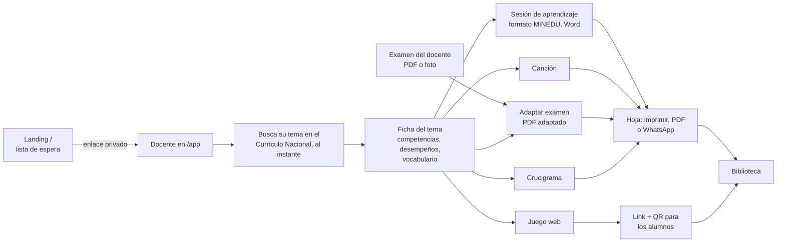

# Mapa — Supermentes

> Todo el producto en una página: qué hace, qué funciona de verdad y qué falta. El porqué está en
> [[VISION]], dónde quedamos en [[ESTADO]] y el evento en [[HACKATHON]].

## El flujo

## Qué hace cada pieza y cómo está

| Pieza | Qué hace | Hoy | Costo | Falta |
| --- | --- | --- | --- | --- |
| Landing `/` | Lista de espera con contador, referidos y fuente | **Real** en producción | Gratis | Promoción (reto de tracción) |
| Currículo | CNEB de Inicial, Primaria y Secundaria como base | **Real** (`packages/curriculo`) | Gratis | — |
| Ficha del tema | Resume el tema con sus desempeños | Ejemplo | Gratis | `POST /api/ficha` con Claude: completa ideas clave y vocabulario en segundo plano (el tema y su currículo ya están) |
| Sesión de aprendizaje | La sesión que el docente entrega al director, en el formato del MINEDU: datos, competencia y capacidades oficiales, criterios con su desempeño citado ("i"), enfoque transversal, materiales, momentos con tiempos (45 o 90 min), ficha de aplicación y escala de valoración para 30. Se corrige con un clic, se imprime o se descarga en Word | **Real** (`api/sesion.ts`, ~35 s; citas verificadas contra `packages/curriculo`) | 1 crédito | Probarla con docentes; Word es un .doc hecho con HTML (abre y se edita, no es .docx nativo) |
| Canción | En 4.º, primero las 2 canciones propias del tema (banco, `apps/web/src/banco`, con cita); cada una con ▶ para escucharla ahí mismo; luego las de YouTube que ya existen (206 de primaria, `apps/web/src/canciones`). Arriba a la derecha, «Crear canción» como en Suno: la letra la escribe Supermentes o el docente, y se elige el ritmo. Todas suenan con Lyria vía `/api/audio` (se guarda en Blob la primera vez) | **Real**: banco, catálogo, letra con `/api/cancion` y audio con `/api/audio` | Gratis las del banco y las existentes; 1 + 3 créditos la nueva | Banco para los otros grados |
| Adaptar examen | El docente sube su examen (PDF o foto) y descarga un PDF ambientado en lo que le gusta a la clase y/o para TDAH, dislexia, TEA o lectura fácil (formato incluido: letra grande, casillas, apoyos) | Código real (`api/examen.ts`; PDF en el navegador). En producción sale el ejemplo hasta configurar la clave | 1 crédito | `OPENROUTER_API_KEY` y `VITE_API=real` en Vercel |
| Juego web | 17 juegos para cualquier tema; 22 habilidades de cálculo; en 4.º cada tema trae sus preguntas y parejas (banco) | **Real** con cálculo, vocabulario y banco de 4.º | Gratis / 1 crédito fuera del banco | Banco para los otros grados |
| Compartir juego | Código de 6 letras y QR para el celular del alumno | **Real** (`api/juegos-compartidos.ts`) | Gratis | Probar en el aula |
| Crucigrama | Grilla con las palabras del docente | **Real** (algoritmo) | Gratis | — |
| Biblioteca | Currículo + materiales de otros profes | Currículo real, materiales de ejemplo | Gratis | Persistencia |
| Créditos | 30 al mes por docente | Solo en el navegador | — | Guardarlos en el servidor; decidir quién paga |

**Lectura rápida:** lo que no usa IA ya funciona (currículo, juegos de cálculo, crucigrama,
compartir). Todo lo que necesita IA sigue con datos de ejemplo: el backend con Claude es el
cuello de botella.

## Piezas técnicas

- **Repo:** `Hecze/supermentes`, rama `main`, monorepo Turborepo. App en `apps/web` (Vite + React),
  funciones de Vercel en `api/`, currículo en `packages/curriculo`, notas en `obsidian/`.
- **Producción:** https://www.supermentes.app (Vercel, cuenta de Hecze). Datos en Vercel Blob.
- **Contratos UI ↔ backend:** `apps/web/src/api/types.ts`. Cambiar de ejemplo a real: `VITE_API=real`.
- **IA prevista:** Claude (texto; lee el examen que sube el docente para adaptarlo), ElevenLabs (audio), ARASAAC (pictogramas).

## Decisiones abiertas

- **Quién paga.** El docente de colegio público no va a pagar con tarjeta. Opciones: colegios
  privados, UGEL/MINEDU, o freemium con donante. Sin decidir.
- **Costo por docente.** Cuánto cuesta en Claude + ElevenLabs un docente activo al mes con 30
  créditos. Sin medir.
- **Qué mostrar en la entrega** (domingo 18, 9:00 a. m.). Cuáles herramientas tienen que funcionar
  con IA real y cuáles pueden quedar como ejemplo.
- **Canal.** Grupos de WhatsApp de docentes y referidos de la lista de espera parecen el canal
  natural; sin probar.
