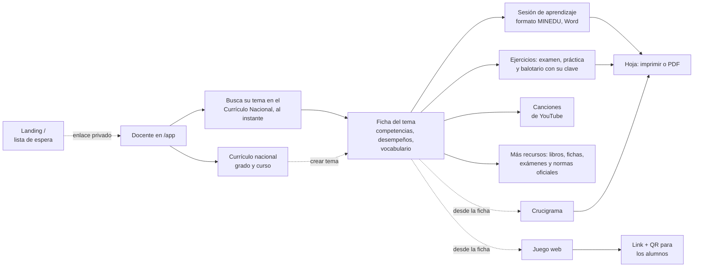

# Mapa — Supermentes

> Todo el producto en una página: qué hace, qué funciona de verdad y qué falta. El porqué está en
> [[VISION]], dónde quedamos en [[ESTADO]] y el evento en [[HACKATHON]].

## El flujo

## Qué hace cada pieza y cómo está

| Pieza | Qué hace | Hoy | Costo | Falta |
| --- | --- | --- | --- | --- |
| Landing `/` | Lista de espera con contador, referidos y fuente | **Real** en producción | Gratis | Promoción (reto de tracción) |
| Currículo | CNEB de Inicial, Primaria y Secundaria como base | **Real** (`packages/curriculo`) | Gratis | — |
| Ficha del tema | Resume el tema con sus desempeños | Ejemplo | Gratis | `POST /api/ficha` con Claude: completa ideas clave y vocabulario en segundo plano (el tema y su currículo ya están) |
| Sesión de aprendizaje | La sesión que el docente entrega al director, en el formato del MINEDU: datos, competencia y capacidades oficiales, criterios con su desempeño citado ("i"), enfoque transversal, materiales, momentos con tiempos (45 o 90 min), ficha de aplicación y escala de valoración para 30. Se arma al instante con el tema y sus desempeños; se ajusta, se corrige con un clic, se imprime o se descarga en Word | **En construcción, no usar** (plantilla instantánea, sin IA; las citas del currículo se verifican, pero el desarrollo, el enfoque y la ficha no salen de una norma del MINEDU) | Gratis | Revisar cada parte contra las fuentes oficiales del MINEDU; sale solo si cumple todas (todo o nada, ver `CLAUDE.md`) |
| Canción | No se crean canciones en la app (19-oct, `CANCIONES.md`): salen de nuestro canal de YouTube, una por tema para todos. Solo las que están en YouTube, en una sola lista: las de nuestro canal y las de otros (206 de primaria, `apps/web/src/canciones`); el nombre del canal dice de quién es | **Real**: catálogo | Gratis | Crear el canal y la página oculta «Canal»; producir las canciones |
| Ejercicios (examen, práctica y balotario) | En 4.º, cada tema trae sus tres hojas armadas para imprimir, desde el tema de la barra lateral (grado y curso no se vuelven a preguntar): preguntas con dibujos de la vida real en Matemática y problemas con recuadro de procedimiento (685, con pasos), preguntas del banco en todos los cursos. Dificultad (fácil, normal, difícil) para la hoja o para una pregunta; billetes y monedas reales del BCRP y fotos del Perú (cuy, combi, papa, choclo…) en los problemas; cambiar, fijar y quitar cada pregunta; «+ Tema» arma la miscelánea (también de varios cursos, buscando); «Otra versión», «Fila A y B», «Armar examen» desde el balotario; encabezado del colegio sobre la hoja; PDF y clave con tabla de respuestas, pasos y la cita de cada pregunta | **Real** (`apps/web/src/examenes`, sin IA) | Gratis | Otros grados (necesitan su banco) |
| Juego web | 17 juegos para cualquier tema; 22 habilidades de cálculo; en 4.º cada tema trae sus preguntas y parejas (banco) | **Real** con cálculo, vocabulario y banco de 4.º | Gratis | Banco para los otros grados |
| Compartir juego | Código de 6 letras y QR para el celular del alumno | **Real** (`api/juegos-compartidos.ts`) | Gratis | Probar en el aula |
| Crucigrama | Grilla con las palabras del docente | **Real** (algoritmo) | Gratis | — |
| Más recursos | Libros y cuadernos del MINEDU, fichas de Refuerzo Escolar por tema, pruebas diagnósticas con su clave, guías y normas vigentes; solo enlaces a la fuente, revisados con fecha (`apps/web/src/recursos`). Arriba, videos y fichas del tema buscados en internet (Exa) | **Real**: 251 tarjetas | Gratis (Exa por tema, con caché de una semana) | Personal Social y Ciencia y Tecnología, pruebas liberadas de la ECE |

**Lectura rápida:** lo que no usa IA ya funciona (currículo, juegos de cálculo, crucigrama,
compartir). Todo lo que necesita IA sigue con datos de ejemplo: el backend con Claude es el
cuello de botella.

## Piezas técnicas

- **Repo:** `Hecze/supermentes`, rama `main`, monorepo Turborepo. App en `apps/web` (Vite + React),
  funciones de Vercel en `api/`, currículo en `packages/curriculo`, notas en `obsidian/`.
- **Producción:** https://www.supermentes.app (Vercel, cuenta de Hecze). Datos en Vercel Blob.
- **Contratos UI ↔ backend:** `apps/web/src/api/types.ts`. Cambiar de ejemplo a real: `VITE_API=real`.
- **IA prevista:** Claude (texto) y ARASAAC (pictogramas). Las canciones salen de nuestro canal de YouTube (`CANCIONES.md`).

## Decisiones abiertas

- **Quién paga.** El docente de colegio público no va a pagar con tarjeta. Opciones: colegios
  privados, UGEL/MINEDU, o freemium con donante. Sin decidir.
- **Costo por docente.** Cuánto cuesta en IA un docente activo al mes, ahora que con cuenta el uso no tiene
  límite (sin créditos desde el 19-oct). Sin medir.
- **Qué mostrar en la entrega** (domingo 18, 9:00 a. m.). Cuáles herramientas tienen que funcionar
  con IA real y cuáles pueden quedar como ejemplo.
- **Canal.** Grupos de WhatsApp de docentes y referidos de la lista de espera parecen el canal
  natural; sin probar.
