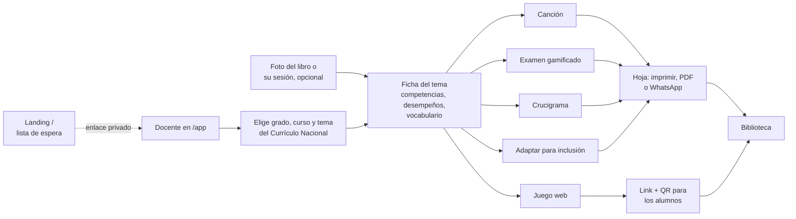

# Mapa — Supermentes

> Todo el producto en una página: qué hace, qué funciona de verdad y qué falta. El porqué está en
> [[VISION]], dónde quedamos en [[ESTADO]] y el evento en [[HACKATHON]].

## El flujo

## Qué hace cada pieza y cómo está

| Pieza | Qué hace | Hoy | Costo | Falta |
| --- | --- | --- | --- | --- |
| Landing `/` | Lista de espera con contador, referidos y fuente | **Real** en producción | Gratis | Promoción (reto de tracción) |
| Currículo | CNEB de Inicial, Primaria y Secundaria como base | **Real** (`packages/curriculo`) | Gratis | — |
| Ficha del tema | Resume el tema con sus desempeños | Ejemplo | Gratis | `POST /api/ficha` con Claude (lee foto/PDF) |
| Canción | Letra con ritmo peruano y luego el audio | Ejemplo | 1 + 3 créditos | `/api/cancion` (Claude) y `/api/audio` (ElevenLabs) |
| Examen | Evaluación ambientada en lo que le gusta a la clase | Ejemplo | 1 + ilustraciones | `/api/examen`, `/api/ilustraciones` |
| Juego web | 6 juegos para cualquier tema; 22 habilidades de cálculo | **Real** con cálculo y vocabulario | Gratis / 1 crédito | `/api/juego` para preguntas del tema |
| Compartir juego | Código de 6 letras y QR para el celular del alumno | **Real** (`api/juegos-compartidos.ts`) | Gratis | Probar en el aula |
| Crucigrama | Grilla con las palabras del docente | **Real** (algoritmo) | Gratis | — |
| Adaptar | Versión para TDAH, dislexia, TEA, lectura fácil | Ejemplo | 1 crédito | `/api/adaptar`, pictogramas ARASAAC |
| Biblioteca | Currículo + materiales de otros profes | Currículo real, materiales de ejemplo | Gratis | Persistencia |
| Créditos | 30 al mes por docente | Solo en el navegador | — | Guardarlos en el servidor; decidir quién paga |

**Lectura rápida:** lo que no usa IA ya funciona (currículo, juegos de cálculo, crucigrama,
compartir). Todo lo que necesita IA sigue con datos de ejemplo: el backend con Claude es el
cuello de botella.

## Piezas técnicas

- **Repo:** `Hecze/supermentes`, rama `main`, monorepo Turborepo. App en `apps/web` (Vite + React),
  funciones de Vercel en `api/`, currículo en `packages/curriculo`, notas en `obsidian/`.
- **Producción:** https://www.supermentes.app (Vercel, cuenta de Hecze). Datos en Vercel Blob.
- **Contratos UI ↔ backend:** `apps/web/src/api/types.ts`. Cambiar de ejemplo a real: `VITE_API=real`.
- **IA prevista:** Claude (texto y lectura de fotos), ElevenLabs (audio), ARASAAC (pictogramas).

## Decisiones abiertas

- **Quién paga.** El docente de colegio público no va a pagar con tarjeta. Opciones: colegios
  privados, UGEL/MINEDU, o freemium con donante. Sin decidir.
- **Costo por docente.** Cuánto cuesta en Claude + ElevenLabs un docente activo al mes con 30
  créditos. Sin medir.
- **Qué mostrar en la entrega** (domingo 18, 9:00 a. m.). Cuáles herramientas tienen que funcionar
  con IA real y cuáles pueden quedar como ejemplo.
- **Canal.** Grupos de WhatsApp de docentes y referidos de la lista de espera parecen el canal
  natural; sin probar.
